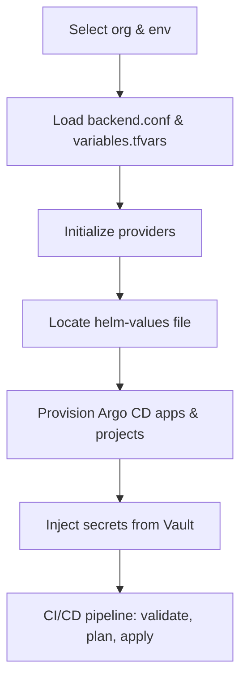

# argo-app | Architecture & Workflow
## Purpose

- Centralize and automate Argo CD application management.
- Support multi-organization and multi-environment deployments.
- Ensure secure secret handling via Vault.
- Provide a clear structure for all team members to understand, maintain, and extend.

---
## Overview

The `argo-app` directory is a Terraform-based solution for managing Argo CD applications and their deployment configurations. It supports multi-organization and multi-environment setups, integrating Helm values, secret management, and CI/CD automation.

---

## Directory Structure

### Top-Level Files

- **.gitlab-ci.yml**  
  Defines CI/CD pipeline for automated validation, planning, and deployment of Terraform changes.

- **main.tf**  
  Entry point for Terraform, orchestrates modules and resources.

- **provider.tf**  
  Declares providers (Kubernetes, Vault, etc.) for resource management.

- **variables.tf / locals.tf**  
  Input variable declarations and local computed values.

- **application.tf / project.tf / repository.tf / repository-credential.tf**  
  Define Argo CD applications, projects, repositories, and repository credentials.

- **vault-secret.tf**  
  Integrates Vault for secure secret management.

---

### variable.d Structure
The `variable.d` folder provides environment and organization-specific configuration for Argo CD application deployments. It enables dynamic selection of variables and backend settings, ensuring each deployment is tailored to its context.

#### lumi/
- **Environments:**  
  - `dr`, `local`, `lumprod`, `prod`, `sgdr`, `sgprod`, `sguat`, `sit`, `uat`
- **Files per environment:**  
  - `backend.conf`: Backend configuration for Terraform state storage (e.g., remote S3 bucket, workspace).
  - `variables.tfvars`: Key-value pairs for environment-specific variables (e.g., cluster name, namespace, repo URL, secrets).

#### starix/
- **Environments:**  
  - `alphadr`, `dr`, `k3sawx`, `k3sbackup`, `k3sdr`, `k3skc`, `k3sprod`, `k3ssit`, `k3suat`, `local`, `nexprod`, `sit`
- **Files per environment:**  
  - `backend.conf`: Backend configuration for Terraform state storage.
  - `variables.tfvars`: Environment-specific variables for Argo CD apps (e.g., cluster, repo, secrets).

### Key Features
- **Multi-organization support:**  
  Separate folders for `lumi` and `starix` organizations.
- **Multi-environment support:**  
  Each environment has its own configuration, allowing isolated and customized deployments.
- **State management:**  
  `backend.conf` ensures Terraform state is stored and managed per environment.
- **Dynamic variable loading:**  
  `variables.tfvars` enables flexible and reusable deployments.

---

### helm-values Structure
The `helm-values` folder contains Helm chart values files for all managed applications. These files define application-specific configuration for each environment and organization, enabling precise control over deployments.

- **Application Subfolders:**  
  Each application (e.g., `awx-operator`, `grafana-grafana`, `kubernetes-ingress`, `mysql-operator`, etc.) has its own subfolder.
- **Values Files:**  
  - Named as `values-<org>-<env>-atomix.yaml` or similar, mapping to organization and environment.
  - Some applications have further nested folders for exporters, operators, etc.

#### Example Applications:
- **awx-operator/**  
  - `values-starix-k3sawx-atomix.yaml`
  - `values-starix-sgprod-atomix.yaml`
- **grafana-grafana/**  
  - `values-global.yaml`
  - `values-starix-k3sdr-atomix.yaml`
  - `values-starix-k3sprod-atomix.yaml`
  - `values-starix-k3sprod-lumi.yaml`
- **kubernetes-ingress/**  
  - Multiple values files for different orgs/environments.

### Key Features
- **Fine-grained configuration:**  
  Each values file customizes the Helm chart for a specific org/environment.
- **Scalability:**  
  Easy to add new applications or environments by creating new values files.
- **Separation of concerns:**  
  Application logic and configuration are decoupled, improving maintainability.

---

## How It Works: Detailed Workflow

1. **Select Organization & Environment**
   - User or pipeline chooses the target organization (`lumi` or `starix`) and environment (e.g., `prod`, `dr`, `k3sprod`).

2. **Load Terraform Variables**
   - Terraform loads `backend.conf` and `variables.tfvars` from the corresponding `variable.d/<org>/<env>/` folder.
   - Backend configuration ensures state isolation.
   - Variables provide context for application deployment (e.g., cluster, namespace, repo, secrets).

3. **Initialize Providers**
   - Terraform initializes providers (Kubernetes, Vault, etc.) using loaded variables.

4. **Reference Helm Values**
   - For each application, the workflow locates the appropriate Helm values file in `helm-values/<app>/values-<org>-<env>-atomix.yaml`.
   - These values are injected into the Helm release via Argo CD or Terraform Helm provider.

5. **Deploy Applications**
   - Terraform provisions Argo CD applications, projects, repositories, and credentials.
   - Helm charts are deployed using the loaded values, ensuring environment-specific configuration.

6. **Manage Secrets**
   - Vault integration (via Terraform) securely injects secrets into applications as needed.

7. **CI/CD Automation**
   - `.gitlab-ci.yml` pipeline automates validation, planning, and application of changes.
   - Ensures consistent, repeatable, and auditable deployments.

---

## Workflow Chart

